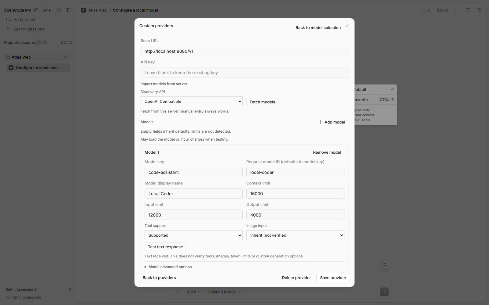

# OpenCode My

**English** · [简体中文](README.zh.md)

OpenCode My is a desktop workspace for long-running agent coding, built on `opencode`. It helps developers work across several projects and follow tasks that take time to complete. It retains OpenCode's coding and agent capabilities and improves desktop interactions, personal workflows, and access to locally hosted models. The desktop edition is maintained on `dev-my`.

- **Control** · Organize sessions by project and see running work and tasks waiting for input, so you can switch projects and intervene when needed.
- **Visibility** · Use project overviews, task status, and session context to see what has finished and what still needs attention.
- **Ease of use** · Use simpler desktop controls, choose the layout and workflow that fit your work, and connect custom or locally hosted models.

## What this project does

OpenCode My is a desktop project in the OpenCode ecosystem. It focuses on how developers work with agents across demanding projects. Desktop enhancements follow upstream conventions and are optional where practical.

### Respond to community feedback

We prioritize community issues with concrete use cases, such as the Side bar layout and connecting custom models hosted locally. We release verified fixes in the fork and submit suitable changes upstream for review.

### Develop and validate new features

We evaluate agent coding features in real workflows when they make tasks easier to control, progress easier to understand, or common actions simpler. Those results inform what we ship in the desktop edition.

## Roadmap

### Released features

#### Side bar

Browse sessions by project or recent activity, and see running and waiting tasks across connected servers.

#### Custom models

Connect an OpenAI-compatible provider from the model picker. Import models or add them manually, test saved models, and choose which ones appear in the picker.

### Planned features

- **Session Overview** · Review long or multi-turn sessions more quickly. The first phase is planned around read-only navigation and finding supporting evidence. [Design draft](docs/fork/dev-my/session-overview.md)

Share feedback and ideas through [GitHub Issues](https://github.com/joe-ieta/OpenCode.My/issues).

## New features in detail in `OpenCode My`

### Side bar

- **Project and list views.** The default **By project** view groups sessions under their projects. **List** sorts sessions across projects by most recent activity.
- **Project controls.** Pin projects for quick access, expand or collapse them with the folder icons, and view branch, worktree, and remote information where available.
- **Project and session menus.** Home and Side bar share actions for importing sessions, editing projects, copying paths, clearing notifications, and closing projects. Open the Side bar project menu with a right-click or **Shift+F10**. Closing a project keeps its history and unsent drafts, and the session menu supports export.
- **Shared counts.** Both views show active sessions / total sessions / projects across the available projects. For example, `2/20/5` means 2 active sessions out of 20 across 5 projects.
- **Home and new sessions.** Home and Side bar share project history. Home project rows show running activity, and **New session** below **Home** uses the project selected there. Project rows also offer shortcuts to start a session in that project.
- **Running sessions.** A dedicated section across connected servers shows active work and waits for input or approval. It includes background Shell tasks and subagents, even when the session is closed in the workspace.
- **Session hover details.** See the branch and worktree, when the last run ended, the number of user messages in the loaded history, the latest effective context usage, and session cost. Recent runs show a relative time.

### Custom models

- **Provider setup.** Create, edit, or remove global OpenAI-compatible providers from **Custom providers**. Set the display name, provider ID, and base URL in the form.
- **Credentials.** Save or replace API keys in the credential store. Editing the provider preserves JSONC comments and fields managed outside the form.
- **Model discovery.** Preview models via OpenAI-compatible `/models` or the native Ollama and LM Studio APIs. Import selected entries, retain manually entered fields, and use discovered models in the runtime catalog.
- **Manual model entries.** Set the display name, request model ID, context, input and output limits, and tool and image capabilities. The form scrolls on shorter windows.
- **Advanced options.** Configure request and streaming timeouts, reasoning and compatibility settings, price tiers, and model variants.
- **Saved-model text test.** Send a small test request using the saved endpoint, credentials, and model ID. Inspect the result, cancel the test, or retry after an error.
- **Model visibility.** Use **Manage models** to choose which models appear in the picker. Close the panel to return to the same picker.
- **Built-in integrations.** Open **Connect an integration** from the picker footer or from the search field on desktop. Confirming removal deletes the integration's saved credentials and refreshes the model catalog.

## Desktop screenshots

- **Side bar** · Choose **Side bar** under **Preferences → Interface layout**. Add projects or search sessions from the sidebar, with pinned projects and running sessions in their own sections.

  

- **Custom models** · Open **Custom providers** from the model picker to fetch models or add them manually. Test a saved model and see the result alongside its configuration.

  

_The custom models screenshot uses sample data._

[Download OpenCode My](https://github.com/joe-ieta/OpenCode.My/releases/latest) · [Desktop maintenance](docs/fork/dev-my/README.md) · [Official OpenCode README](https://github.com/anomalyco/opencode#readme)
