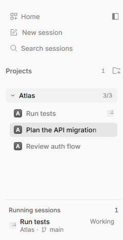

# OpenCode My

**English** · [简体中文](README.zh.md)

OpenCode My is the desktop edition maintained on `dev-my`. It adds an independent Side bar for projects and sessions, and a form for configuring custom models from the model picker.

## Side bar

In **Settings → General → Interface layout**, select **Side bar**. Pin or collapse projects, open recent sessions by project, and start a session from a project row. **Running sessions** shows active work across connected servers, including background Shell work and subagents, with branch and elapsed time when available.

## Custom models

Open the model picker and choose **Custom providers** to add or edit a global OpenAI-compatible provider. Enter a base URL, save an optional API key in the credential store, then fetch and import models or enter them manually. Set the display name, request model ID, and context limit, then use **Test text response** to check that the model answers. **Manage models** controls which models appear in the picker.

_Screenshots use sample data._

[Download OpenCode My](https://github.com/joe-ieta/opencode/releases) · [Desktop maintenance](docs/fork/dev-my/README.md) · [Official OpenCode README](https://github.com/anomalyco/opencode#readme)
