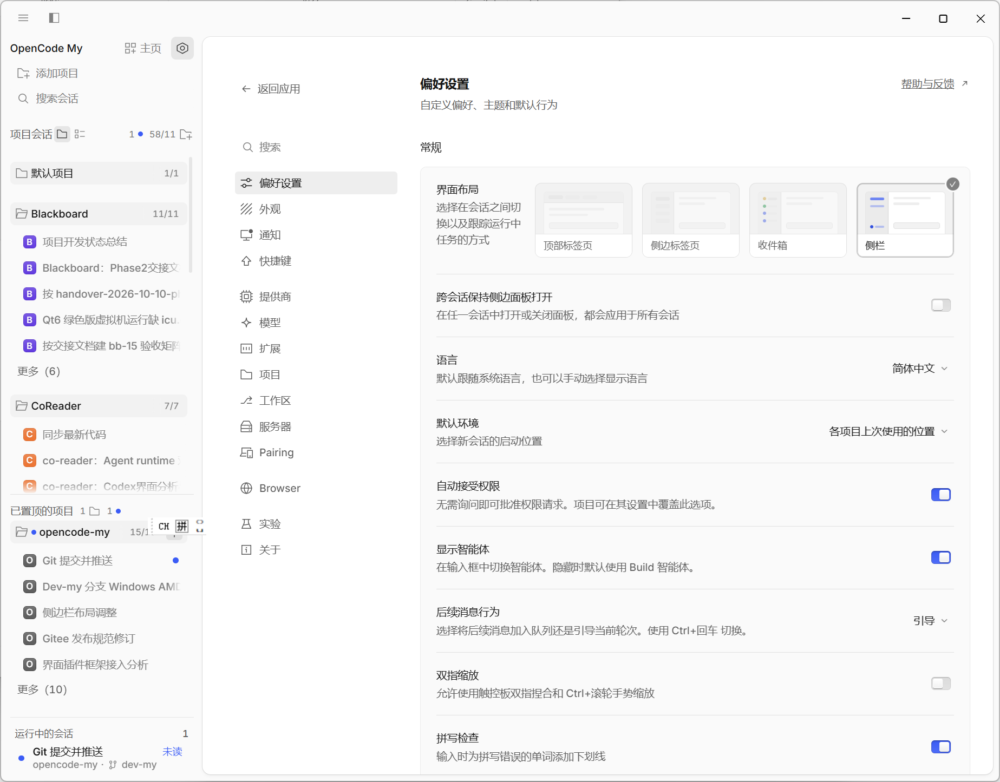

# OpenCode My

[English](README.md) · **简体中文**

OpenCode My 是面向日常开发的桌面 AI 编程工作台。基于 OpenCode，保留完整的编程与智能体能力，重点优化使用界面、个性化流程和本地模型体验。桌面版在 `dev-my` 分支维护。

## 个性化功能

- **侧栏（Side bar）** · 在 **设置 → 常规 → 界面布局** 中选择 **侧栏**。可置顶或收起项目，按项目浏览最近会话，并集中查看已连接服务器上的运行活动，包括后台 Shell 和子智能体。

  

- **自定义模型（Custom models）** · 在模型选择器中打开 **自定义 Provider**，配置全局 OpenAI 兼容 Provider。可发现并导入模型，也可手动添加，设置模型显示名称、请求 ID 与上下文限额，并测试文本响应。通过 **管理模型** 选择在模型选择器中显示的模型。

  

_截图使用示例数据。_

[下载 OpenCode My](https://github.com/joe-ieta/opencode/releases) · [桌面维护说明](docs/fork/dev-my/README.md) · [官方 OpenCode README](https://github.com/anomalyco/opencode#readme)
