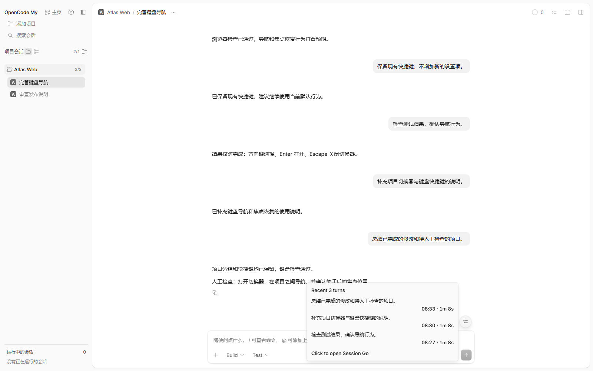
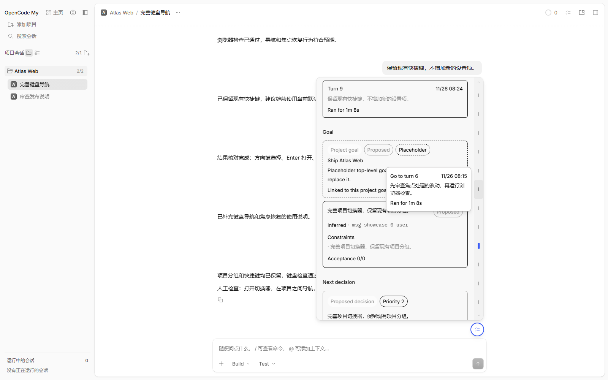

# OpenCode My

[English](README.md) · **简体中文**

OpenCode My 是基于 `opencode` 的桌面 Agent 长程编程工作台，面向需要并行推进多个项目、持续跟进长时间编程任务的开发者。它保留 `opencode` 的编程与 Agent 能力，重点改进桌面交互、个性化工作流程和本地模型接入。桌面版在 `dev-my` 分支维护。

- **可控** · 按项目组织会话，集中查看正在运行和等待处理的任务，便于在多个项目之间切换和介入。
- **易理解** · 通过项目概览、任务状态和会话上下文掌握进展，了解哪些工作已完成、哪些仍需处理。
- **易用** · 简化常用桌面操作，支持按需选择界面布局和工作流程，并改善自定义模型和本地部署体验。

## 本项目做什么

OpenCode My 是 OpenCode 生态中的桌面项目，聚焦高负荷开发中的人机协作。桌面增强沿用上游的使用习惯，并尽量允许按需启用。

### 跟进社区反馈

优先处理有明确使用场景的社区问题，例如侧栏布局和本地部署的自定义模型接入。修复验证后随 fork 发布，适合上游的改动会提交给官方，并跟进审核。

### 研发与验证新特性

选择有助于控制任务、理解进展或简化操作的 Agent 编程能力，在实际工作流程中验证后再决定是否纳入桌面版。

## 下载

[当前候选版 `v2.4.1-my-0.1.27-rc`](https://github.com/joe-ieta/OpenCode.My/releases/tag/v2.4.1-my-0.1.27-rc) 已包含 Session Go。[最新正式版](https://github.com/joe-ieta/OpenCode.My/releases/latest) 提供侧栏和自定义模型。两个版本均提供 Windows x64 安装包，以及 Linux amd64 和 arm64 的 AppImage 和 deb 包。

## 桌面功能

### 侧栏（Side bar）

- **切换布局**。打开 **设置 → 偏好设置 → 界面布局**，选择 **侧栏**。通过侧栏顶部可打开首页或设置、添加项目和搜索会话。
- **按项目与列表视图**。默认「按项目」将会话按项目分组。「列表」将跨项目会话按最近活动从新到旧排列。
- **项目操作**。可置顶项目，通过文件夹图标展开或收起项目，并查看可用的分支、工作树与远端信息。
- **项目与会话菜单**。首页与侧栏共用导入会话、编辑项目、复制路径、清除通知和关闭项目等操作。侧栏项目菜单可用右键或 **Shift+F10** 打开。关闭项目会保留历史会话与未发送草稿，会话菜单支持导出。
- **统一计数**。两种视图都显示所有可见项目的「活跃会话数 / 会话总数 / 项目总数」。例如 `2/20/5` 表示 5 个项目共有 20 个会话，其中 2 个活跃。
- **首页与新建会话**。首页与侧栏共享项目历史。首页项目行显示运行状态并提供新建会话入口。点击侧栏中项目旁的 **+**，可直接在该项目中新建会话。
- **运行中的会话**。跨已连接服务器集中显示运行中、等待输入和等待批准的任务，包含后台 Shell 与子智能体，也能看到工作区中未打开的会话。
- **会话悬停详情**。显示分支、工作树、上次运行结束时间、已加载历史中的用户消息轮次、最近有效上下文用量和会话费用。近期运行以相对时间显示。

### Session Go（长会话回顾）

从会话顶部打开 Session Go，可在保留原对话时间线的同时回顾长会话。也可以通过悬浮按钮打开面板，沿轮次导航跳转到各条用户消息。在 **设置 → Session Go** 中可管理此功能。

- **目标、决策与行动**。按本地规则从会话历史提取候选条目，集中查看目标、待处理决策，以及 Shell 命令和测试运行等已记录的行动。
- **搜索与来源定位**。在已加载的历史中搜索消息和事实。需要更早的消息时，点击 **Load full history**，再用 **Reveal** 跳回原对话中的来源。
- **确认事实**。可确认、推迟或拒绝候选决策，并在本地保留已确认的事实及其证据。原始消息保持完整。
- **模型辅助分析**。点击 **Analyze loaded session** 可让当前会话配置的模型整理候选条目，产生的模型用量计入该会话。每段执行结束后自动分析默认关闭。

### 自定义模型（Custom models）

- **Provider 管理**。通过「自定义 Provider」新增、编辑或删除全局 OpenAI 兼容 Provider，在表单中填写显示名称、Provider ID 和 Base URL。
- **凭据管理**。在独立的凭据存储中保存或替换 API Key。编辑 Provider 时保留 JSONC 注释和表单以外的配置字段。
- **模型发现**。通过 OpenAI 兼容 `/models` 或 Ollama、LM Studio 原生 API 预览模型，可勾选导入并保留手工填写的字段。发现的模型可进入运行时目录。
- **手动录入模型**。可填写显示名称、请求模型 ID、上下文与输入输出限额，以及工具和图像能力。矮窗口下表单可滚动查看。
- **高级选项**。支持配置请求与流式响应超时、推理和兼容选项、价格阶梯以及模型变体。
- **已保存模型的文本测试**。使用已保存的地址、凭据和模型 ID 发出最小测试请求，可查看结果、取消测试或在失败后重试。
- **模型可见性**。在「管理模型」中选择哪些模型显示在选择器里，关闭管理面板后可返回原选择器。
- **内置集成连接**。可从模型选择器底部打开「连接提供商」，桌面端搜索框旁也有入口。确认移除后会删除该集成已保存的凭据，并刷新模型目录。

## 桌面界面截图

以下为桌面界面构建的完整窗口截图，使用示例数据。Session Go 面板当前使用英文标签。

- **侧栏（Side bar）** · 当前对话与项目分组并列，侧栏集中显示多个已连接服务器上正在运行的会话。

  

- **Session Go：悬浮按钮与提示** · 悬停在发送按钮上方的圆形按钮，可预览最近三轮用户消息及运行时长；点击打开悬浮窗口。

  

- **Session Go：悬浮窗口与轮次轨道** · 点击右侧轨道中的轮次标记，跳转至原对话；悬停在其他标记上，可预览该轮消息与运行时长，保留当前选择。

  

- **自定义模型（Custom models）** · 在模型选择器中打开 **自定义 Provider**，可获取或手动添加模型，并在同一表单中查看已保存模型的文本测试结果。

  

[提交使用反馈](https://github.com/joe-ieta/OpenCode.My/issues) · [桌面维护说明](docs/fork/dev-my/README.md) · [官方 OpenCode README](https://github.com/anomalyco/opencode#readme)
