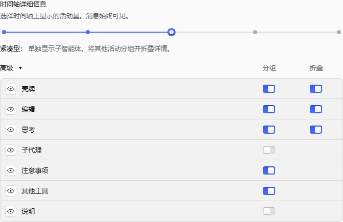
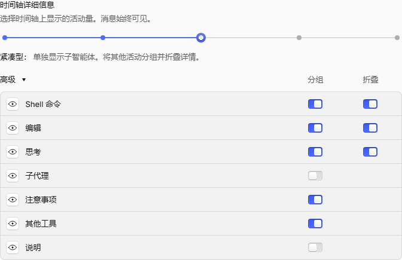
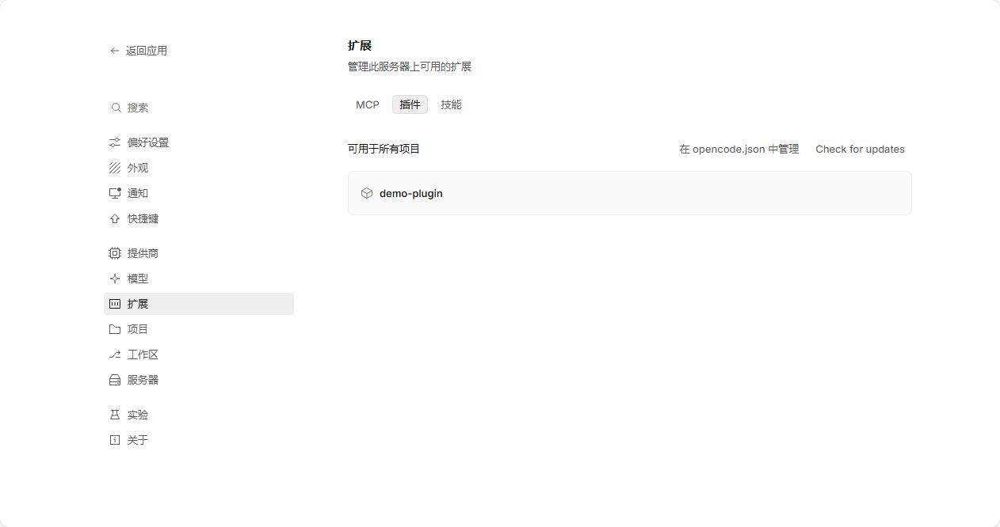
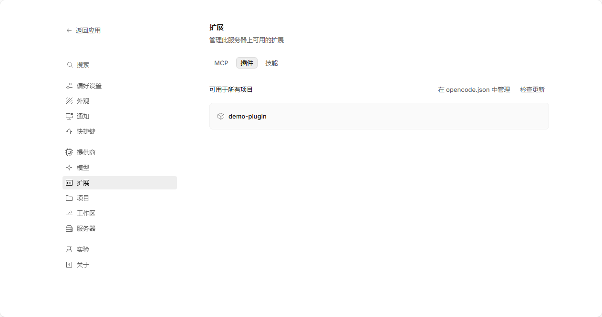
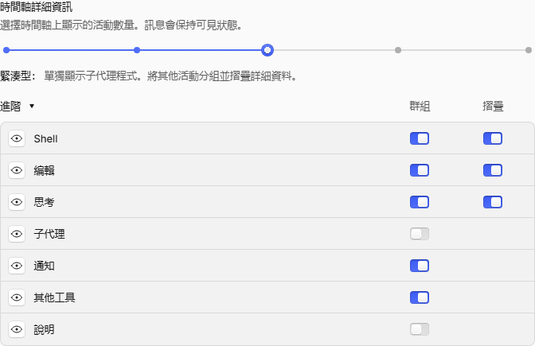
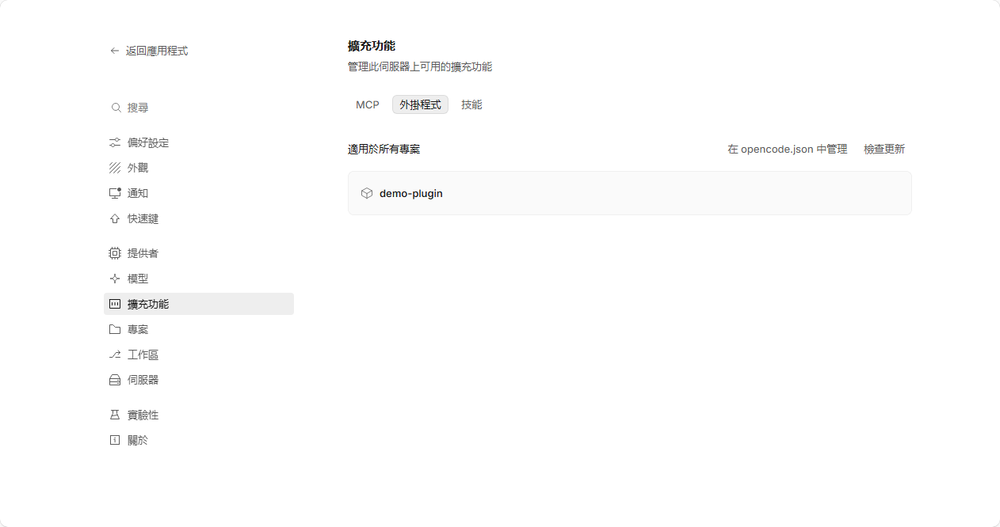

# PR #65049 visual review

Evidence for [anomalyco/opencode#65049](https://github.com/anomalyco/opencode/pull/65049), captured on 2026-11-20 in isolated Chromium with mocked projects and sessions.

- Before: the original PR's upstream parent `cd0d037d68f389230c6452f846b3a43635cf2bf9`.
- After: reviewed translation commit `c054c39f75bf9019a614eeba0f86aeae965a78eb`.
- Production components and the app's existing e2e API/storage fixtures were used. There is no user session data in the screenshots.
- These images are review evidence only and are not included in the official PR's translation patch.

| Screen | Before (Simplified Chinese) | After (Simplified Chinese) |
| --- | --- | --- |
| Timeline |  |  |
| Extensions |  |  |

Traditional Chinese after:

